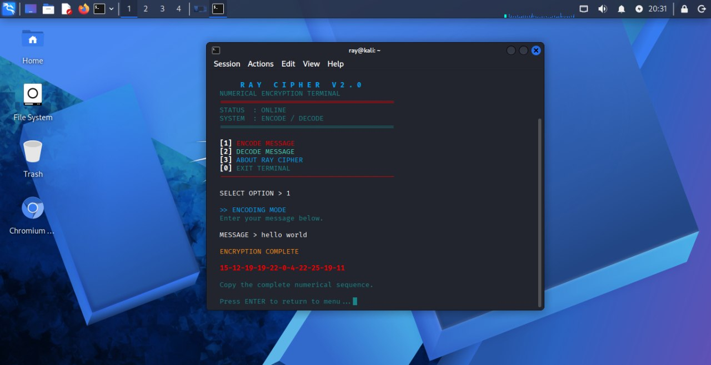
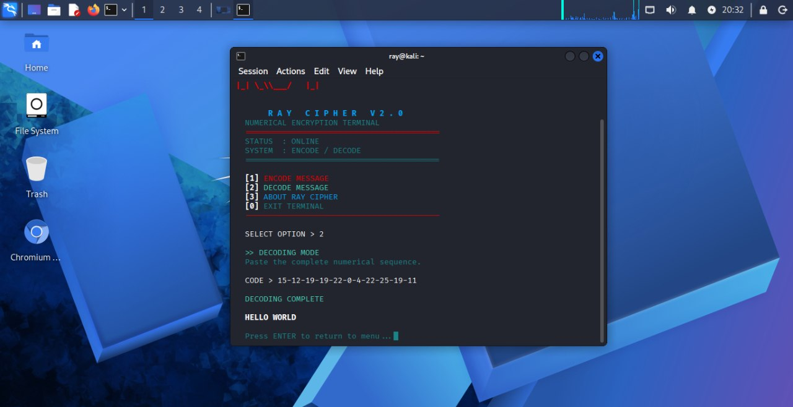

# Ray Cipher

**A Python-based numerical encoding and decoding system.**

Ray Cipher is an educational command-line project built with Python. It converts alphabetic text into numerical sequences using a fixed alphabet shift and allows users to decode the sequences back into readable text.

## Features

- **Encode:** Convert text into numerical sequences.
- **Decode:** Restore encoded sequences to readable text.
- **Terminal interface:** Colored output and a centered ASCII banner.
- **Interactive menu:** Simple options for encoding, decoding, and viewing project information.
- **Lightweight:** Uses Python's standard library without additional dependencies.

## Project Structure

| File | Description |
| --- | --- |
| `ray_cipher.py` | Main Ray Cipher encoder and decoder. |
| `README.md` | Project documentation. |

## Requirements

- Python 3
- A terminal or command-line interface

No third-party Python packages are required.

## Installation

Clone the repository:

```bash
git clone https://github.com/RayH4T/ray-cipher.git
cd ray-cipher
```

## Usage

Run Ray Cipher:

```bash
python3 ray_cipher.py
```

Follow the on-screen menu to encode or decode a message.

## Example

**Input:**

```text
WHO IS RAY
```

**Encoded output:**

```text
15-12-19-19-22-0-4-22-25-19-11
```

## How It Works

Ray Cipher applies a fixed alphabet shift derived from an internal key. Letters are converted into numbers, while spaces are represented by `0`. Numbers are separated by hyphens.

## Screenshots

### Decode Example


### Encode Example


## Disclaimer

Ray Cipher is intended for educational purposes and experimentation with basic cryptography concepts. It is not secure encryption and should not be used to protect passwords, confidential information, or sensitive communications.

## Author

**RAY**

## License

No license has been specified yet.
